# Kompass

**A money coach in your pocket, built for Deutsche Bank's Hackathon.** Bite-sized, game-like money lessons, personalized to your country, your confidence and your language.

<p align="center">
  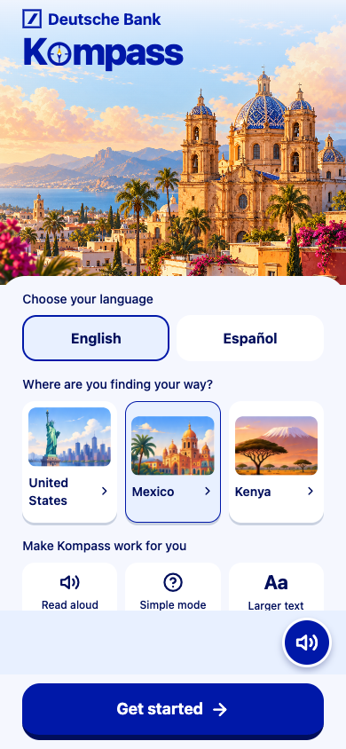
  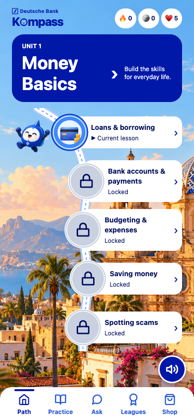
  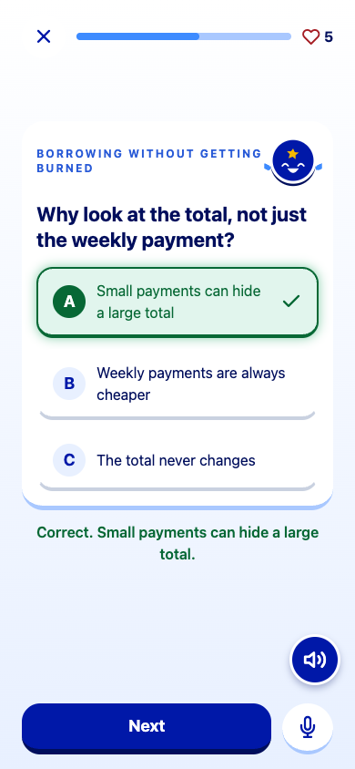
</p>

|  |  |
|---|---|
| 🌎 **Local** | US, Mexico or Kenya: local currency, banks and World Bank Findex facts |
| 🎯 **Personal** | Your weakest topics come first |
| 🧭 **Ask Kiko** | Ask a money question and it becomes a new lesson |
| 🔊 **Voice-first** | Every screen works by voice alone |
| 🗣️ **3 languages** | English, Spanish, Swahili |

---

## 1. Set up

Pick your language, country and life stage.

<p align="center">
  
  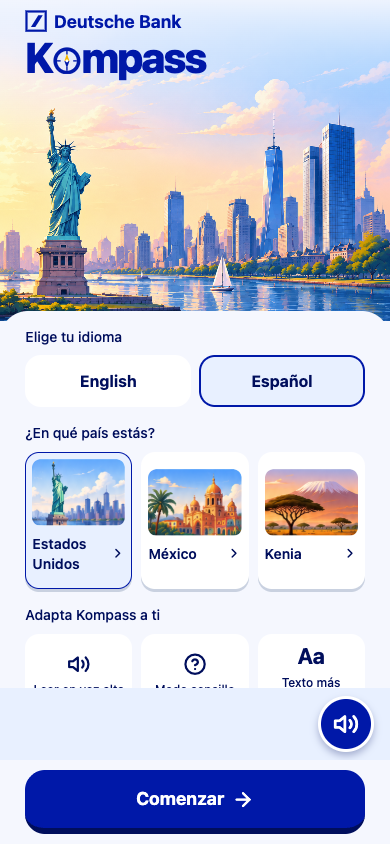
  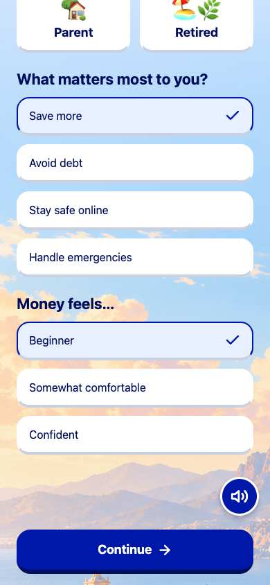
</p>

## 2. Find your starting point

Rate your confidence, take a 10-question quiz, and get your path.

<p align="center">
  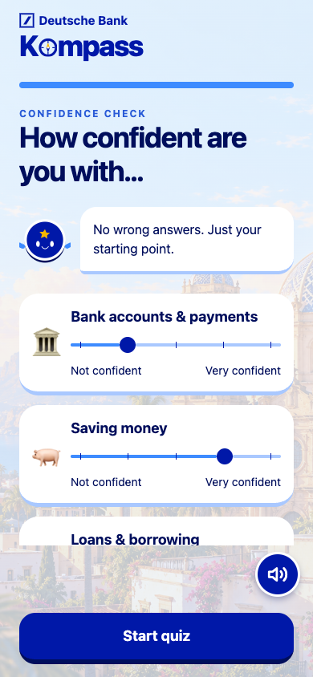
  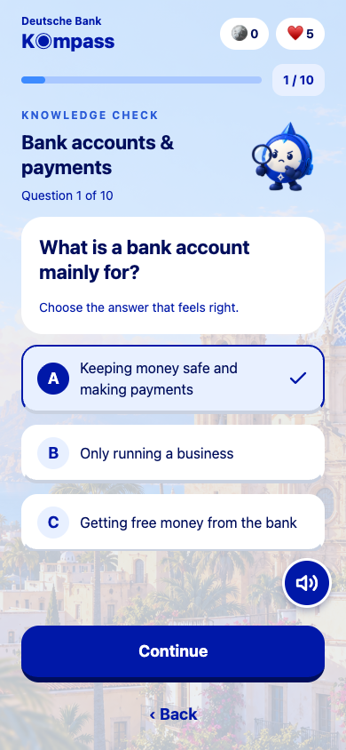
  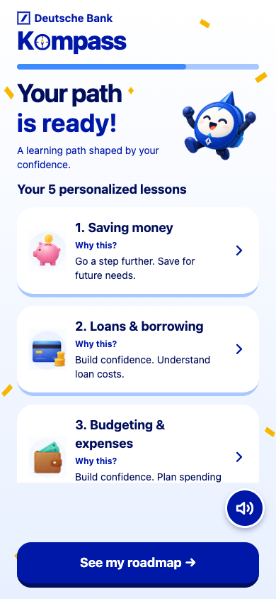
</p>

## 3. Follow the roadmap

Finish a lesson to unlock the next. Kiko's lessons join the path with a **NEW** badge.

<p align="center">
  
  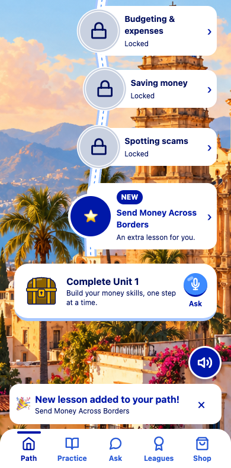
</p>

## 4. Learn one card at a time

Reveal, flip, quiz, spot the scam. Right answers glow, wrong ones cost a heart.

<p align="center">
  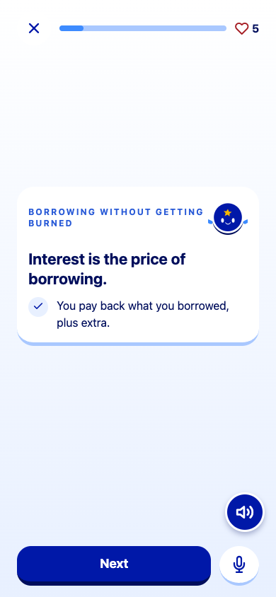
  
  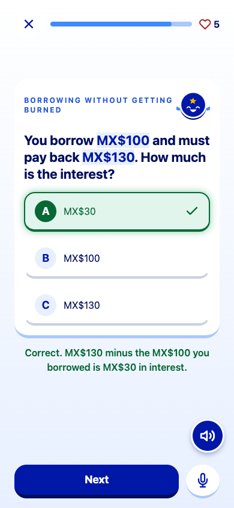
  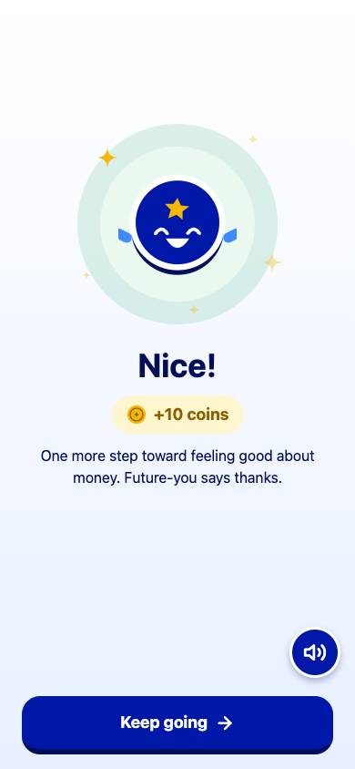
</p>

## 5. Ask Kiko, then spend your coins

<p align="center">
  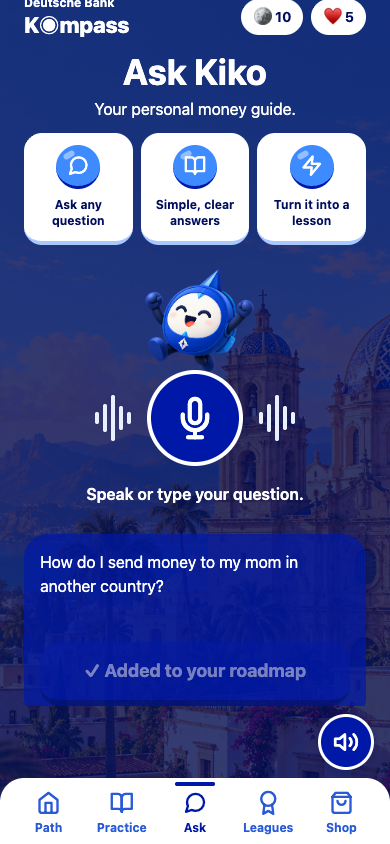
  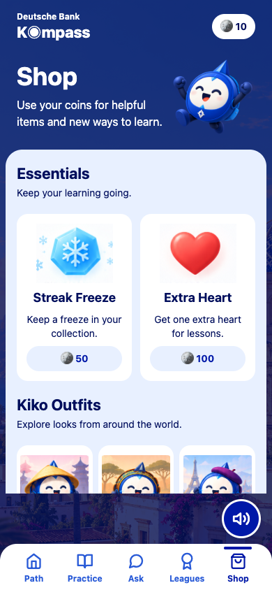
  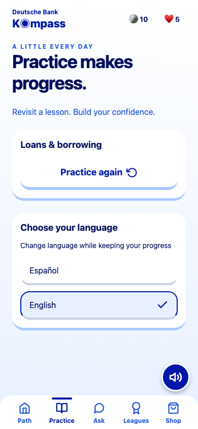
  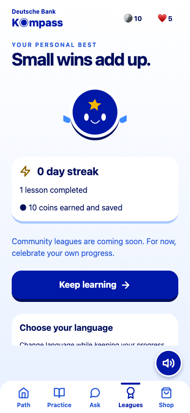
</p>

🔊 The speaker button on every screen reads it aloud, and the 🎤 lets you answer by voice.

---

## How it works

```
Expo app  ──▶  FastAPI  ──▶  scoring ranks your topics
                        ──▶  lesson templates + Findex facts  ──▶  LLM rewords them (checked, with a template fallback)
                        ──▶  speech-to-text for Ask Kiko  ──▶  new lesson on your path
```

**Stack:** Expo React Native · TypeScript · NativeWind · Zustand · TanStack Query · FastAPI · Pydantic · SQLite

## Run it

**API** (Python 3.11). Copy `.env.example` to `api/.env` and add your LLM key.

```bash
cd api && pip install -r requirements.txt && uvicorn app.main:app --reload
```

**App** (Expo SDK 54). Set `EXPO_PUBLIC_API_URL=http://127.0.0.1:8000` in `app/.env`. On a phone, use your computer's LAN address instead.

```bash
cd app && npm ci && npx expo start
```

Press **w** for the browser, or scan the QR code with Expo Go.

## Team

Built by [@faraz999shah](https://github.com/faraz999shah), [@willapat](https://github.com/willapat) and [@annabeltu](https://github.com/annabeltu).
